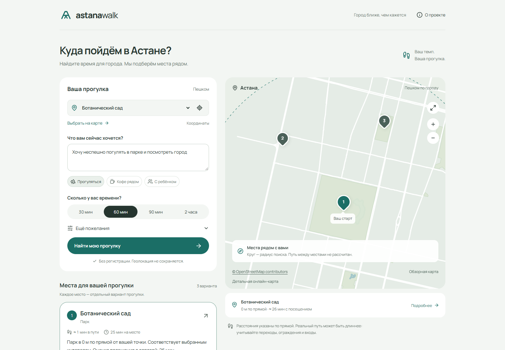

# Astana Walk

Ограничение по времени можно отключить тумблером «Сколько у вас времени?». В API это `time_enabled=false` (по умолчанию `true`): длительность посещения и дороги больше не исключает место, но оценки остаются в карточках. Радиус и остальные фильтры действуют независимо.

Подробные растровые тайлы OpenStreetMap включены по умолчанию: видны улицы, здания и названия. Масштабирование доступно скроллом, пальцами и кнопками до z19. На метках есть карточки с адресом; кнопка старта возвращает к выбранной точке. В «Слой карты» можно отключить внешние тайлы и включить локальную схему. Внешняя карта передаёт OSM IP и область просмотра; подробности в docs/PRIVACY.md.

`TWOGIS_API_KEY` в `.env` включает 2ГИС Places API с приоритетом перед OSRMRoute/Overpass. Поиск по типу или названию выполняется при отправке формы вокруг выбранной точки. Ключ хранится только на сервере. Демо-ключ поддерживает 5 объектов на странице; для одиночного запроса приложение запрашивает до 3 страниц (до 15 кандидатов, максимум 12 карточек). Это расходует до 3 запросов Places API на один поиск; несколько явно выбранных типов запрашиваются отдельно. Время ожидания ограничено 14 секундами после разбора пожелания. Ключи/полные внешние URL не выводятся в ошибки. Для отключения 2ГИС очистите `TWOGIS_API_KEY` и перезапустите backend.

Карточки 2ГИС содержат реальные ID, координаты, адреса и рубрики источника; отсутствие OSM-тегов не удаляет эти результаты. Неизвестные часы работы, розетки и доступность остаются неизвестными. Расстояние и время остаются оценочными; маршруты OSRMRoute пока не подключены. При сбое 2ГИС показан явно обозначенный снимок OSM; успешный пустой ответ не заменяется другим источником.

Кнопки типов в интерфейсе — быстрые фильтры, а не полный перечень доступных мест. Для произвольного запроса Gemini формирует проверенные по синтаксису OSM key:value фильтры: стадионы, аптеки, ветеринарные клиники, веломагазины и другие типы проходят через онлайн-поиск и карточки без добавления в фиксированный enum. Модель выбирает только тип; названия, координаты и ссылки объектов приходят от источника. Несколько типовых запросов распознаются локально для ускорения. Нераспознанный запрос и пустая база не означают, что заведения не существует.

При заполненном `OSRMROUTE_API_KEY` в `.env` онлайн-поиск использует OSRMRoute Places API вместо Overpass. Ключ передаётся только сервером в Authorization header. Простые запросы категорий обрабатываются без Gemini; для сложных пожеланий остаётся разбор Gemini. Ожидание Places ограничено 14 секундами, дополнительные повторные запросы к Overpass и Gemini при сбое не выполняются. При ошибке показан сохранённый каталог с явным предупреждением. Нужны подтверждённый email, разрешение Places и доступные кредиты OSRMRoute.

OSRMRoute также использует OpenStreetMap: это не каталог 2ГИС/Google и не гарантия полноты заведений. Для каждой категории запрашивается до 50 ближайших объектов, затем применяются радиус, бюджет времени и подтверждённые удобства. Часы работы и доступность, отсутствующие в ответе, остаются неизвестными. Пешеходные маршруты через OSRMRoute пока не подключены; расстояния и время по-прежнему оценочные.

ИИ-помощник по прогулкам в Астане для Build with AI / НИЦ Smart City.

1162 реальных POI из OpenStreetMap, автоматический сбор, поиск по типу и названию, строгие фильтры и подробная карта OpenStreetMap с локальным обзорным слоем на случай отсутствия сети. Поиск показывает до 12 **отдельных вариантов** с источниками и оценкой времени; начальный пример содержит три места.



## Быстрый запуск

Нужны Python 3.12, [uv](https://docs.astral.sh/uv/getting-started/installation/) и Node.js 22+.

```powershell
git clone https://github.com/DiasTleumurat/astana_walk.git
cd astana_walk
./start.ps1
```

Скрипт устанавливает зафиксированные зависимости, собирает интерфейс, готовит локальную embedding-модель и запускает приложение: **http://127.0.0.1:8000**. Первый запуск требует интернет для зависимостей и модели (~220 МБ). Затем демо работает автономно. Для быстрого резервного режима без загрузки модели: `./start.ps1 -LexicalOnly`.

Ручной запуск на Linux/macOS:

```bash
uv sync --frozen
cd frontend
npm ci
npm run build
cd ..
uv run python -m ingestion.cli index
uv run uvicorn backend.main:app --host 127.0.0.1 --port 8000 --no-access-log
```

Для разработки backend запускается той же командой с `--reload`, frontend — `npm run dev` из `frontend/`. Vite проксирует `/api` на порт 8000.

## Docker

```bash
docker compose up --build
```

Адрес тот же. По умолчанию модель загружается при сборке образа. Для сборки без модели: `docker compose build --build-arg DOWNLOAD_MODEL=false`, затем `docker compose up`. Такой запуск честно показывает резервный лексический поиск. Docker-конфигурация включена; если Docker недоступен на машине автора, её проверка отмечена в отчёте.

## Деплой на Render

В репозитории есть `render.yaml`. В [Render](https://dashboard.render.com) выберите New → Blueprint, подключите этот репозиторий и введите `GEMINI_API_KEY` и `TWOGIS_API_KEY` (оба необязательны). Render соберёт Dockerfile и будет пересобирать приложение после каждого push в `main`. На бесплатном тарифе семантический поиск выключен из-за лимита памяти 512 МБ, а после 15 минут простоя сервис засыпает: первое открытие занимает до минуты.

## Демо и Gemini

Без ключа приложение использует локальные embeddings и шаблонные объяснения. Это демонстрационный retrieval + template режим, а не вызов генеративной модели. Интерфейс показывает режим явно.

Для Gemini скопируйте `.env.example` в `.env`:

```dotenv
LLM_PROVIDER=gemini
GEMINI_API_KEY=your-key
GEMINI_MODEL=gemini-3.5-flash-lite
GEMINI_GOOGLE_SEARCH=false
```

Перезапустите backend. Имя модели конфигурируемое: используйте доступную вашему ключу модель. Интеграция использует REST `generateContent`. Ключ отправляется заголовком и никогда не попадает в браузер или URL. `.env` исключён из Git; не используйте переменные с префиксом `VITE_` для ключа.

После нажатия «Найти мою прогулку» Gemini получает текст пожелания, нормализованные фильтры и найденные места с источниками. Точная стартовая координата отдельно не передаётся. Ответ показывается отдельным блоком со ссылками, карточки и карта остаются на основе каталога. Первичная загрузка примера не расходует API-квоту (`use_ai=false`). При сбое ключа, квоты или сети остаются карточки и понятное сообщение. Автоматические тесты не обращаются к Google даже при наличии ключа в `.env`.

По умолчанию используется бесплатная генерация по каталогу: это не проверка событий и часов работы в реальном времени. Для свежих веб-результатов задайте `GEMINI_GOOGLE_SEARCH=true` и модель с доступом к Google Search grounding. При отсутствии подтверждённых веб-источников ответ не выдаётся за результат онлайн-поиска. У новых аккаунтов Gemini 2.5 может быть недоступна, а Google Search у новых моделей не входит в бесплатный тариф: проверьте [актуальные условия Google](https://ai.google.dev/gemini-api/docs/pricing) перед включением. Приложение само не переключает аккаунт на платный тариф.

Карта поддерживает колёсико мыши, жест двумя пальцами и кнопки масштаба. Геолокация запрашивается кнопкой рядом с выбором старта; для телефона нужен HTTPS, на компьютере также подходит localhost. Разрешите доступ в браузере и системных настройках. При отказе, таймауте или положении вне поддерживаемой области остаётся выбор старта вручную.

## Что попробовать

1. Ботанический сад → «Прогуляться» → 60 минут. Откройте данные и источники первого места.
2. Левый берег → «Кофе рядом». Выберите карточку и найдите её номер на карте.
3. Район EXPO → «С ребёнком». Сравните оценки времени.
4. В дополнительных пожеланиях включите подтверждённые розетки: пустая выдача объясняет отсутствие данных.
5. Откажите в геолокации: район, карта и ручные координаты остаются доступны.

## Сбор и обновление данных

При отправке формы включён `LIVE_PLACE_SEARCH=true`: после разбора пожелания сервер запрашивает подходящие объекты непосредственно у Overpass API. Карточки и координаты формируются из свежего ответа OpenStreetMap, а не из памяти Gemini. Поиск использует городскую область, не передаёт точную координату посетителя источнику и не сохраняет результаты запроса на диск. Под картой отображается время получения ответа. Первичный пример при открытии страницы остаётся локальным и не вызывает внешние сервисы.

При ошибке публичных серверов используется сохранённый каталог с явным предупреждением; успешный пустой онлайн-ответ не подменяется снимком. Актуальный запрос не гарантирует полноту OSM, открытое заведение или свободные места. Для отключения внешних запросов задайте `LIVE_PLACE_SEARCH=false`. Онлайн-поиск OpenStreetMap не требует платного ключа; `GEMINI_GOOGLE_SEARCH` — отдельная настройка веб-поиска Google.

```bash
uv run python -m ingestion.cli collect
uv run python -m ingestion.cli normalize
uv run python -m ingestion.cli validate
uv run python -m ingestion.cli index
uv run python -m ingestion.cli stats
# Полный цикл с подготовкой нового индекса до публикации снимка:
uv run python -m ingestion.cli refresh
# Независимое обновление обзорной геометрии карты:
uv run python -m ingestion.basemap
```

После обновления перезапустите backend; после изменения карты пересоберите frontend. Сбор выполняется через фиксированные Overpass endpoints. При ошибке предыдущий рабочий снимок сохраняется. Снимок и индекс версионированы; ключ индекса содержит модель и хеш содержимого. `normalize` публикует только валидный нормализованный снимок, `refresh` предварительно строит индекс. Датасет и карта включены в репозиторий; модель и производная SQLite-база игнорируются Git.

## Проверки

```bash
uv run pytest -q
uv run python scripts/evaluate.py
cd frontend
npm run build
# При работающем backend на 8000 и установленном Chrome:
npm run test:e2e
```

Тесты pytest и browser e2e не требуют ключей или обращения к внешним сервисам. Скрипт оценки использует локальный snapshot и доступный локальный индекс. В отчёте обязательно проверяйте `retrieval_mode`, чтобы не принять lexical за hybrid.

Текущая проверка поиска: **67 backend-тестов** и сборка frontend. Предыдущие browser-проверки и ограничения описаны в [отчёте проверки](docs/VALIDATION.md).

## Структура

- `backend/`: API, SQLite/FTS5, embeddings, ограничения, расписания, Gemini.
- `frontend/`: React/TypeScript, Leaflet, Motion, Playwright.
- `ingestion/`: воспроизводимый сбор и нормализация OSM.
- `data/poi.json`: реальные POI и происхождение полей.
- `tests/`: граничные случаи и 20 оценочных запросов.
- `docs/`: архитектура, паспорт данных, приватность, сценарий защиты и результаты.

## Ограничения

Расстояния считаются по прямой. Время пешком — оценка со скоростью 4.5 км/ч и коэффициентом 1.3; реальная дорожная сеть, переходы и перекрытия не рассчитываются. Радиус не является гарантированной пешеходной достижимостью. Указанные точки крупных объектов могут быть их геометрическими центрами, а не входами.

Расписания понимаются консервативно: неподдерживаемые конструкции и данные старше 180 дней дают `unknown`. Праздники, актуальные события, цены, шум, погода и безопасность ночного пути не подтверждены. Явные фильтры имеют приоритет. При настроенном Gemini тип, название, отрицания и кухня извлекаются до поиска; без API работает строгий разбор известных слов. Неизвестный тип или отсутствующее название не заменяются случайными ближайшими местами. Начальную точку задаёт форма, названия локаций из текста автоматически не геокодируются. Русский — единственный язык UI MVP. Компьютерные клубы в OSM покрыты неполно; тег internet_cafe не гарантирует игровые ПК, это отмечено на карточке.

## Данные и лицензии

Данные и обзорная карта: **© OpenStreetMap contributors**, [ODbL 1.0](https://www.openstreetmap.org/copyright). Производный датасет распространяется с теми же условиями; он отделён от исходного кода. См. `data/LICENSE.txt`.

Код — MIT. Интерфейс использует Motion, Leaflet, Lucide и Manrope; сторонние лицензии перечислены в `docs/THIRD_PARTY.md`. Применённые дизайн-навыки и принятые решения описаны в `DESIGN.md`.
