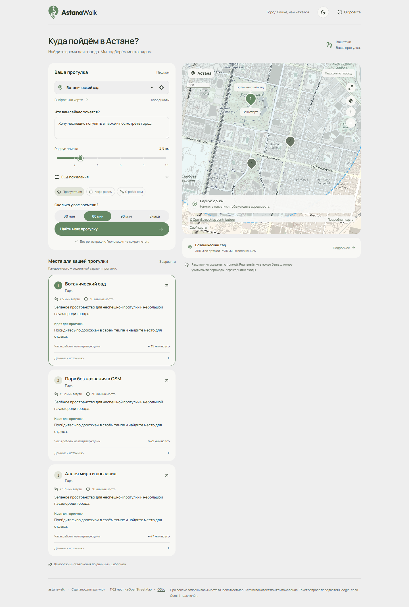
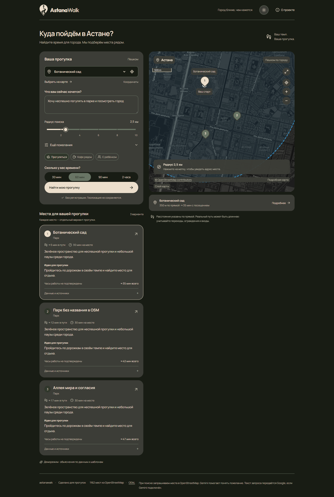

# AstanaWalk — финальная спецификация макета

Снимок текущего макета для переноса в основной проект. Версия от 19 октября 2026 года. Основной вариант надписи — **Outfit**, светлая тема «Шалфей», тёмная тема «Лес». Все файлы в этом комплекте локальные; загрузка шрифтов с внешних сервисов не требуется.

## Состав комплекта

- `assets/astanawalk-logo.svg` — векторный знак, прозрачный фон, кривые SVG без встроенного растрового изображения.
- `assets/fonts/` — Outfit, Fjalla One, Special Gothic Expanded One, Manrope и лицензии.
- `assets/styles/fonts.css` — подключение Manrope, включая кириллицу.
- `assets/styles/layout.css` — полный снимок стилей текущего интерфейса; содержит подключения шрифтов логотипа, адаптивную сетку и состояния компонентов.
- `assets/styles/theme.css` — финальные цвета двух тем и оформление карты; подключается последним и переопределяет исходные цвета в `layout.css`.
- `reference-src/` — снимок React-компонентов для сверки структуры и поведения. Это исходники интерфейса, а не самостоятельное готовое приложение.
- `previews/` — актуальные изображения финальных макетов на компьютере и телефоне.

Относительные пути в CSS уже настроены под структуру папки `assets/`. Сохраняйте эту структуру при переносе.

## Логотип

Использовать знак из `assets/astanawalk-logo.svg` слева от слова **AstanaWalk**, без пробела, с заглавными A и W. Шрифт надписи — Outfit Variable. Вес «Astana» — 750, «Walk» — 450. Кегль — 24 px, межбуквенный интервал −1 px, расстояние между знаком и словом — 10 px.

Знак: 36 × 48 px, `mask-size: contain`, без обрезания. На экране до 700 px: знак 31 × 42 px, надпись 22 px, промежуток 6 px. Цвет знака берётся из `--accent`: зелёный в светлой теме и кремовый в тёмной. Текст логотипа использует `--text`.

Для перекрашивания использовать SVG как CSS-маску. Обычный `` с этим SVG будет отображать собственный цвет файла, а не цвет родительского текста.

```html
<a class="brand" href="/" aria-label="Astana Walk — главная">
  <span class="brand-mark" aria-hidden="true"></span>
  <span>Astana<span class="brand-light">Walk</span></span>
</a>
```

SVG имеет `viewBox="0 0 648 856"`. Для иконки вкладки можно использовать этот же файл. Для отдельной цветной версии SVG задайте атрибут `fill` нужным HEX-цветом. Исходный знак был переведён в вектор с небольшим сглаживанием контуров.

## Шрифты

- **Outfit Variable, 100–900** — финальная надпись AstanaWalk. Файл `Outfit-Variable.ttf`.
- **Manrope Variable, 200–800** — весь интерфейс, включая русские тексты. В комплекте WOFF2-подмножества с исходными `unicode-range`.
- **Fjalla One Regular, 400** — альтернативный вариант надписи из сравнения. Файл `FjallaOne-Regular.ttf`.
- **Special Gothic Expanded One Regular, 400** — второй альтернативный вариант. Файл `SpecialGothicExpandedOne-Regular.ttf`.

В основном макете альтернативные гарнитуры не используются. Их можно не переносить, если выбор Outfit окончательный. Лицензии OFL лежат рядом со шрифтами; сохраняйте их при передаче комплекта.

Типографика интерфейса: главный заголовок 30 px / 1.3, вес 650, интервал −1 px; заголовки секций 16 px / 700; основной текст 14 px; поля и текст карточек преимущественно 13 px; подписи 11–12 px. Точные размеры и мобильные изменения зафиксированы в `layout.css`.

## Палитра светлой темы

Исходная палитра: **#658864, #B7B78A, #DDDDDD, #EEEEEE**. Дополнительные оттенки ниже соответствуют финальному макету.

```css
--ground: #EEEEEE;       /* фон страницы */
--surface: #F8F8F5;      /* панели, поля и карточки */
--text: #283326;         /* основной текст */
--muted: #566452;        /* второстепенный текст */
--accent: #658864;       /* кнопки, знак, активные элементы */
--border: #DDDDDD;
--soft: #E2E5D9;         /* мягкие выделения и подложки */
--hover: #D7DDCE;
--selected: #658864;
--on-accent: #FFFFFF;
--accent-hover: #506E4F;
--glass: #F8F8F5F2;      /* панели поверх карты */
--map-ground: #DDDDDD;
```

## Палитра тёмной темы

Исходная палитра: **#181C14, #3C3D37, #697565, #ECDFCC**. Основной акцент в финальной версии — кремовый; приглушённый зелёный используется для границ и дополнительных маркеров.

```css
--ground: #181C14;
--surface: #3C3D37;
--text: #ECDFCC;
--muted: #C2BDAB;
--accent: #ECDFCC;
--border: #697565;
--soft: #30372B;
--hover: #4B5545;
--selected: #697565;
--on-accent: #181C14;
--accent-hover: #F4E9D8;
--glass: #3C3D37F2;
--map-ground: #282F24;
```

Переключение тем: атрибут `data-theme="light"` или `data-theme="dark"` на `<html>`. Предпочтение хранится в `localStorage` под ключом `astana-walk-theme`; если оно ещё не задано, текущий компонент учитывает системную тему.

## Карта

Круг радиуса **голубой #38A9EF в обеих темах**, независимо от основного акцента сайта. Обводка 2.5 px, прозрачность 0.95, пунктир `8 6`. Заливка тем же цветом: прозрачность 0.10 в светлой теме, 0.14 в тёмной. Радиус в метрах изменяется через Leaflet; визуальный переход реализован в компоненте `RadiusControl` / `WalkMap`.

```tsx
pathOptions={{
  className: 'search-radius',
  color: '#38A9EF',
  fillColor: '#38A9EF',
  weight: 2.5,
  opacity: 0.95,
  dashArray: '8 6',
  fillOpacity: 0.1,
}}
```

Неактивные маркеры — #697565. Активный маркер — `--accent`, его подпись — `--on-accent`. Границы маркеров — `--surface`. Картографические тайлы имеют приглушённую обработку:

```css
/* Светлая тема */
filter: grayscale(.8) sepia(.15);
/* Тёмная тема */
filter: grayscale(1) invert(1) sepia(.2) hue-rotate(30deg)
        brightness(.65) contrast(.85);
```

Фильтр применяется только к `.leaflet-tile-pane`, чтобы не менять цвет круга, маркеров и элементов управления. Атрибуция OpenStreetMap сохраняется.

## Компоновка и компоненты

На компьютере: шапка с логотипом, слоганом, переключателем темы и кнопкой «О проекте»; ниже заголовок «Куда пойдём в Астане?» с подзаголовком. Затем две колонки: форма и список мест слева, карта с выбранным местом справа. В форме сохраняются стартовая точка, запрос, радиус, дополнительные пожелания, сценарии прогулки, время и кнопка поиска.

Базовый контейнер — `max-width: 1164px`, горизонтальные отступы 32 px. Сетка рабочей области — `5fr 7fr`, промежуток 24 px. Основные панели и карточки — радиус скругления 22 px, форма — отступ 22 px, карточки мест — 20 px. Поля — скругление 10–12 px, основная кнопка — капсула высотой 48 px. Шапка — 86 px, на телефоне 70 px. Дополнительные правила для широких экранов от 1600 px и экранов до 1000/700 px находятся в `layout.css`.

На телефоне интерфейс перестраивается в одну колонку с переключением «Список / Карта». Сохраняются SVG-знак и надпись, элементы управления не должны создавать горизонтальную прокрутку. Состояния фокуса, выбранных элементов и уменьшенного движения сохраняются из базовых стилей.

## Перенос в основной проект

1. Скопировать папку `assets` целиком в публичные файлы основного проекта, например `public/astanawalk-design/assets/`.
2. Если переносится текущая разметка интерфейса, подключить CSS в следующем порядке:

```html
<link rel="stylesheet" href="/astanawalk-design/assets/styles/fonts.css">
<link rel="stylesheet" href="/astanawalk-design/assets/styles/layout.css">
<link rel="stylesheet" href="/astanawalk-design/assets/styles/theme.css">
<link rel="icon" type="image/svg+xml"
      href="/astanawalk-design/assets/astanawalk-logo.svg">
```

3. Если в основном проекте уже есть собственные компоненты и глобальные стили, перенести токены из `theme.css`, подключения шрифтов и правила логотипа в существующую систему стилей. Полный `layout.css` содержит глобальные правила для `body`, кнопок, полей и заголовков — подключать его целиком следует при переносе текущего интерфейса.
4. Заменить старую картинку логотипа на `.brand-mark`, установить Outfit для надписи. Удалить PNG из пути отрисовки логотипа.
5. Подключить цвета к компонентам через переменные, задать атрибут темы на `<html>` и сохранить переключатель.
6. В компоненте Leaflet явно указать голубые `color` / `fillColor` круга. Одного CSS-переопределения недостаточно, если в основном проекте используется Canvas-рендерер карты.
7. При переносе `reference-src/` адаптировать пути импорта, подключить зависимости из приложенного `package.json`, CSS Leaflet и собственные API. Путь к SVG-маске находится в `assets/styles/layout.css` и уже задан относительно этого CSS. В точке входа приложения подключить три файла стилей в указанном выше порядке.

В комплект не входят серверная логика, ключи API, зависимости `node_modules` и локальная база мест. Демонстрационные результаты на изображениях показывают оформление; расстояния и время в них не являются проверенными маршрутами. Страница сравнения палитр и её переключатель шрифтов служат только для просмотра вариантов и не входят в пользовательский интерфейс основного сайта.

## Проверка после применения

- Убедиться, что загружаются SVG и локальные шрифты, русские буквы отображаются Manrope.
- Проверить обе темы, переключение, подписи и состояния кнопок.
- Проверить знак при увеличении и на экране с высокой плотностью пикселей.
- Проверить голубой круг радиуса и его изменение на карте в обеих темах.
- Проверить телефон шириной 390 px: отсутствие горизонтальной прокрутки, доступность формы и карты.





Мобильные версии: [светлая](previews/light-mobile.png), [тёмная](previews/dark-mobile.png).
